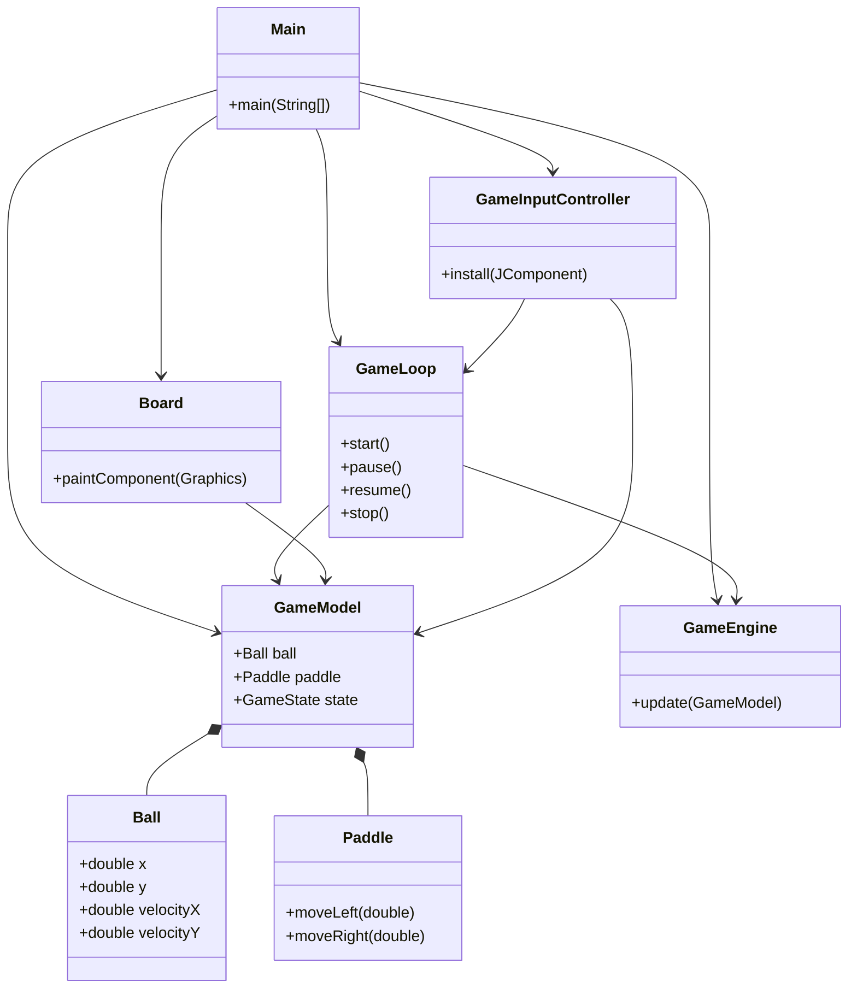

# Actividades 4, 5, 6 y 7

## Actividad 4. Movimiento y colisiones

La posición y la velocidad de la pelota se representan con valores `double`. La velocidad horizontal y vertical se almacenan por separado en `Ball`. En cada actualización, `GameEngine` calcula la siguiente posición, limita la pelota a los bordes izquierdo, derecho y superior, e invierte solo la componente de velocidad asociada al borde alcanzado.

El rebote con la raqueta ocurre únicamente cuando la pelota desciende y cruza el borde superior de la raqueta durante el avance. La comprobación compara el recorrido horizontal entre la posición actual y la siguiente, por lo que no depende de que el incremento vertical termine exactamente sobre la raqueta. Tras el rebote, la pelota se recoloca justo encima de la raqueta para impedir inversiones repetidas.

La condición explícita para una pelota perdida es `GAME_OVER`: cuando su borde inferior supera el límite inferior, se coloca en el último límite válido, el ciclo de actualización se detiene y se muestra el estado de fin de juego.

## Actividad 5. Arquitectura refactorizada

`GameModel`, `Ball` y `Paddle` forman el modelo. `GameEngine` concentra el movimiento y las colisiones. `Board` dibuja una instantánea del modelo y no lo modifica. `GameInputController` interpreta las teclas. `GameLoop` controla el temporizador de Swing y las transiciones de estado.

## Actividad 6. Interacción y controles

| Tecla | Acción | Regla de estado |
|---|---|---|
| Flecha izquierda | Mueve la raqueta 80 píxeles a la izquierda. | Solo en `RUNNING`; se limita a `x = 0`. |
| Flecha derecha | Mueve la raqueta 80 píxeles a la derecha. | Solo en `RUNNING`; se limita a `x = ancho - anchoRaqueta`. |
| Barra espaciadora | Pausa el juego. | Solo cambia de `RUNNING` a `PAUSED`. |
| R | Reanuda el juego. | Solo cambia de `PAUSED` a `RUNNING`. |

Los controles se registran mediante Key Bindings con `WHEN_IN_FOCUSED_WINDOW`. Esto evita depender del foco directo de una ventana o de un `KeyListener`. `GameLoop` tiene una única instancia de `Timer`; iniciar repetidamente un temporizador ya activo no crea ciclos adicionales.

## Actividad 7. Pruebas y verificación

Las pruebas automatizadas se ejecutan sin interfaz Swing mediante `bash gradlew test`. La última ejecución terminó con `BUILD SUCCESSFUL`.

| ID | Caso de prueba | Evidencia automatizada | Resultado esperado |
|---|---|---|---|
| CP-01 | Iniciar el juego | Transición `PAUSED` a `RUNNING` en `GameLoop`. | Se inicia un único ciclo de actualización. |
| CP-02 | Pausar el juego | Transición a `PAUSED` en `GameLoop`. | La pelota no recibe nuevas actualizaciones. |
| CP-03 | Reanudar el juego | Transición de `PAUSED` a `RUNNING` en `GameLoop`. | La animación continúa. |
| CP-04 | Cerrar la aplicación | `GameLoop.stop()`. | El temporizador se detiene y el estado pasa a `STOPPED`. |
| CP-05 | Colisión con pared izquierda | `GameEngineTest.reboundsAtLeftWallAndKeepsBallInsideBoard`. | Se invierte la velocidad horizontal. |
| CP-06 | Colisión con pared derecha | `GameEngineTest.reboundsAtRightWallAndKeepsBallInsideBoard`. | Se invierte la velocidad horizontal. |
| CP-07 | Colisión con límite superior | `GameEngineTest.reboundsAtTopWallAndKeepsBallInsideBoard`. | Se invierte la velocidad vertical. |
| CP-08 | Colisión con la raqueta | `GameEngineTest.reboundsWhenCrossingPaddleTop`. | La pelota rebota sobre la raqueta. |
| CP-09 | Movimiento de la raqueta | `PaddleTest.remainsWithinBoardLimits`. | La raqueta no sale del tablero. |
| CP-10 | Pelota perdida | `GameEngineTest.changesToGameOverWhenBallPassesBottomLimit`. | El estado cambia a `GAME_OVER`. |
| CP-11 | Pausar y reanudar repetidamente | Transiciones idempotentes de `GameLoop`. | No se crean temporizadores adicionales. |
| CP-12 | Colisión cerca del borde de la raqueta | `GameEngineTest.reboundsWhenReachingPaddleEdge`. | Se considera el tamaño de ambos objetos. |

Las nueve pruebas incluidas cubren el ciclo de ejecución, los límites laterales, el límite superior, el rebote con la raqueta y su borde, la pelota perdida y los límites de movimiento de la raqueta.
